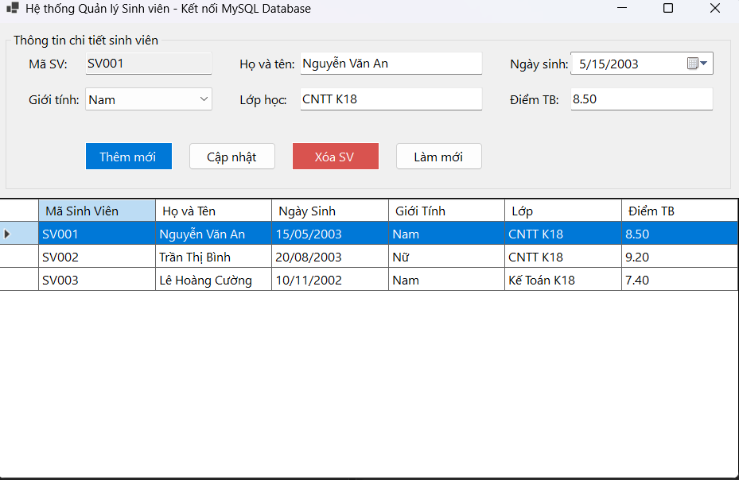
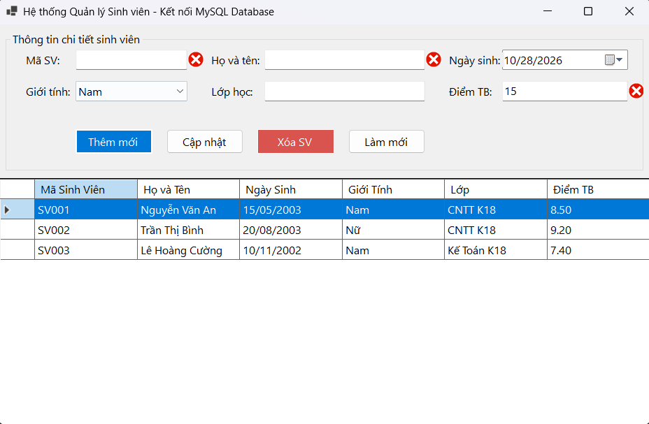
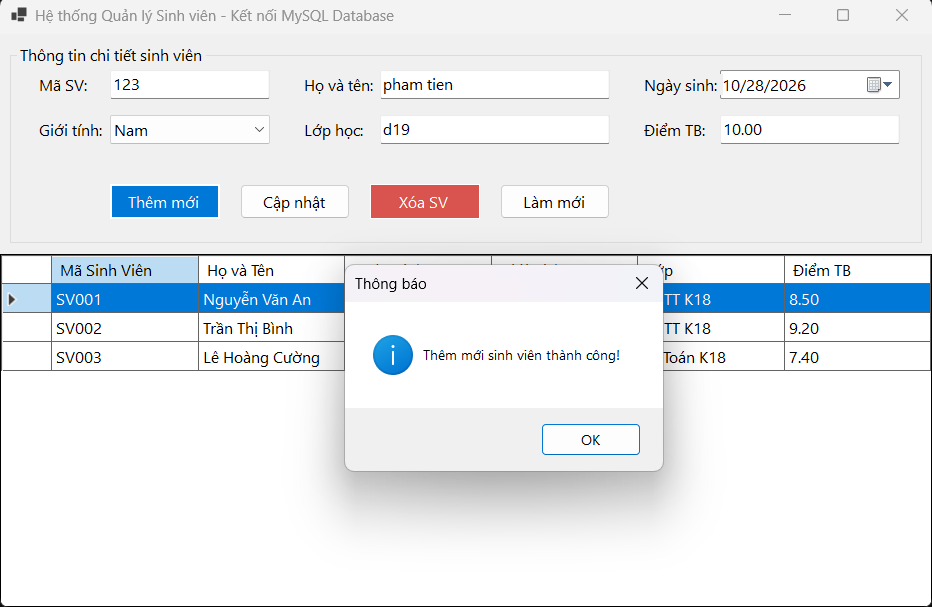

# BÁO CÁO BÀI TẬP THỰC HÀNH LẬP TRÌNH C# WINFORMS - KẾT NỐI CƠ SỞ DỮ LIỆU MYSQL

## I. THÔNG TIN SINH VIÊN
- **Họ và tên:** Phạm Xuân Tiến
- **Mã số sinh viên:** 24810320273
- **Lớp:** D19QTANM1
- **Môn học:** Lập trình C# / Windows Forms
- **Tên bài tập:** Quản lý Sinh viên kết nối MySQL Database (`ql_sinhvien`)

---

## II. THÔNG TIN HỆ THỐNG & CƠ SỞ DỮ LIỆU
- **Hệ quản trị CSDL:** MySQL (chạy trên máy chủ XAMPP - Port 3306)
- **Cơ sở dữ liệu:** `ql_sinhvien`
- **Bảng dữ liệu:** `SinhVien` (`MaSV`, `HoTen`, `NgaySinh`, `GioiTinh`, `Lop`, `DiemTB`)
- **Công nghệ / Thư viện:** C# .NET Windows Forms, `MySql.Data` (Oracle)

---

## III. CÁC TÍNH NĂNG ĐÃ HOÀN THÀNH
1. **Kết nối & Tải dữ liệu:** Tự động truy vấn câu lệnh `SELECT` và tải danh sách sinh viên lên `DataGridView` khi khởi chạy form.
2. **Đồng bộ dữ liệu:** Nhấp chọn dòng bất kỳ trên bảng sẽ tự động đưa thông tin chi tiết lên các điều khiển nhập liệu phía trên.
3. **Ràng buộc & Kiểm tra hợp lệ (Validation):** Sử dụng `ErrorProvider` để kiểm tra:
   - Mã sinh viên và Họ tên không được để trống.
   - Điểm trung bình hợp lệ trong khoảng `0.00` đến `10.00`.
   - Bắt lỗi trùng khóa chính (`Primary Key`) khi thêm mới.
4. **Thao tác dữ liệu (CRUD):**
   - **Thêm mới (INSERT):** Lưu sinh viên mới vào MySQL và cập nhật ngay lên bảng.
   - **Cập nhật (UPDATE):** Chỉnh sửa thông tin sinh viên đã chọn.
   - **Xóa (DELETE):** Hộp thoại xác nhận trước khi xóa bản ghi khỏi CSDL.
   - **Làm mới:** Xóa trắng form để nhập sinh viên mới.

---

## IV. HÌNH ẢNH MINH HỌA KẾT QUẢ

### 1. Giao diện chính và kết nối CSDL (SELECT)

*Minh họa: Tải danh sách sinh viên từ CSDL MySQL lên DataGridView thành công.*

### 2. Bắt lỗi ràng buộc dữ liệu (Validation)

*Minh họa: ErrorProvider cảnh báo khi thông tin không hợp lệ.*

### 3. Kết quả thao tác Thêm / Cập nhật sinh viên (INSERT/UPDATE)

*Minh họa: Thêm mới bản ghi sinh viên thành công vào CSDL.*

---

## V. HƯỚNG DẪN CÀI ĐẶT & CHẠY
1. Khởi động module **MySQL** trên **XAMPP Control Panel**.
2. Tạo database `ql_sinhvien` và chạy script tạo bảng `SinhVien`.
3. Mở Solution bằng Visual Studio và nhấn **F5** để khởi chạy ứng dụng.
